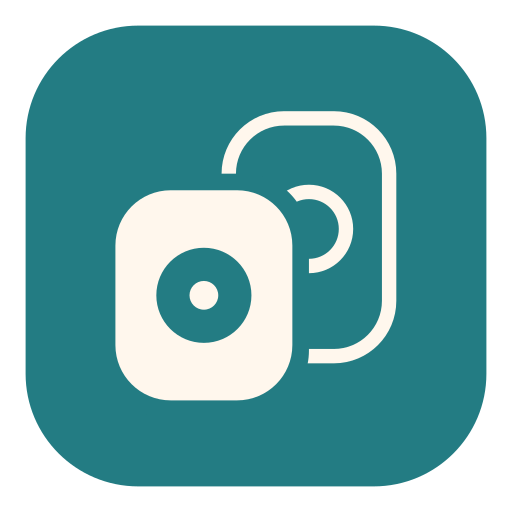
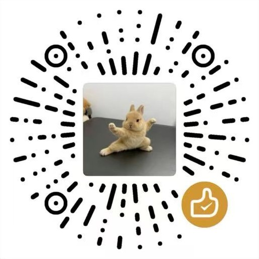

<h1 align="center">MiCast Go</h1>

将手机、电脑上的音频投送到小米智能音箱，支持单台播放与全屋播放。

  
  
  

  <a href="https://github.com/DyMode/MiCast-Go/releases/latest">📦 下载应用</a> ·
  <a href="https://github.com/DyMode/MiCast-Go/issues">💬 问题反馈</a> ·
  <a href="https://github.com/DyMode/MiCast">🔗 了解 MiCast</a>

## ✨ 功能

- 米家扫码登录，自动保存登录状态并续期。
- 每台音箱独立的经典 AirPlay / DLNA 投送入口，可逐台开启或关闭。
- 全屋播放，可逐台加入或移出；没有成员时自动关闭入口。
- 不同音箱分别播放不同音源，支持音量、静音与延迟调节。
- MP3、FLAC、WAV、PCM 音频输出。
- 歌曲信息匹配与带屏音箱显示，显示内容由小米曲库及音箱固件决定。
- 音频链接播放、暂停与停止控制。
- 可选管理密码登录，支持开启、关闭和修改密码。

## 📦 飞牛安装

从 [发布页](https://github.com/DyMode/MiCast-Go/releases/latest) 下载适合自己 NAS 的安装包，在应用中心手动安装，阅读并同意用户协议与隐私政策。打开应用后扫码连接米家。

| NAS 架构 | 安装包 |
| --- | --- |
| x86-64 | [micast-go-x86-0.1.1.fpk](https://github.com/DyMode/MiCast-Go/releases/download/v0.1.1/micast-go-x86-0.1.1.fpk) |
| ARM64 | [micast-go-arm-0.1.1.fpk](https://github.com/DyMode/MiCast-Go/releases/download/v0.1.1/micast-go-arm-0.1.1.fpk) |

点击音箱的房屋图标加入全屋播放，选择“MiCast Go”入口即可向已加入的音箱播放。

管理密码在设置中配置。卸载时可选择保留全部、仅删除登录信息或删除全部应用数据。

## 🧱 技术架构

投送拓扑、播放生命周期、DLNA / AirPlay 实现、音频管线、诊断与部署见 [docs/ARCHITECTURE.md](docs/ARCHITECTURE.md)。

## 🔎 与 MiCast 的区别

[MiCast](https://github.com/DyMode/MiCast) 提供音频投送、多音箱同步、立体声组合与逐台调音，适合需要更多调音与组合功能的用户。

| 产品 | 主要能力 |
| --- | --- |
| MiCast Go | 独立音箱入口、全屋播放、经典 AirPlay、DLNA、音量与延迟调节 |
| [MiCast](https://github.com/DyMode/MiCast) | 经典 AirPlay、DLNA、立体声组合、均衡器、夜间模式与播放诊断；部分版本提供可选的实验性 AirPlay 2 |

两个应用使用独立配置与登录信息，可同时安装。同一台音箱同时接受两个应用的控制时，播放会被后发指令切换。

## ❤️ 赞赏开发

<table>
<tr><th>微信赞赏</th><th>支付宝</th></tr>
<tr><td align="center"></td><td align="center"></td></tr>
</table>

赞赏自愿，不影响功能使用。收款图为 DyMode 各项目通用。

## 💬 联系与许可

联系邮箱：[support@dymode.com](mailto:support@dymode.com) · [问题反馈](https://github.com/DyMode/MiCast-Go/issues)

[用户协议](internal/server/web/user-agreement.txt) · [隐私政策](internal/server/web/privacy-policy.txt)

项目代码使用 [MIT 许可](LICENSE)。第三方组件许可见 [licenses](licenses)，FFmpeg 对应源码与构建材料作为独立附件提供。
