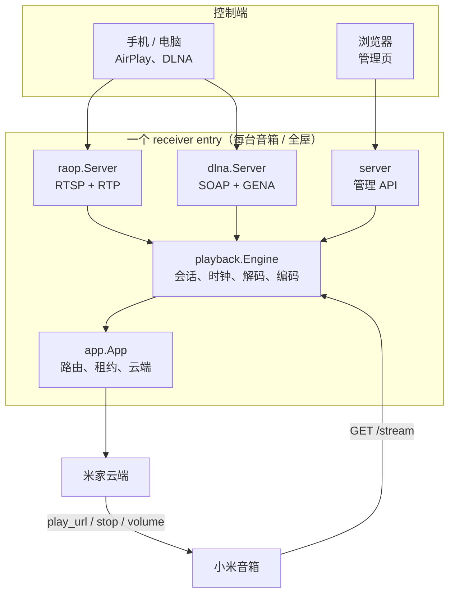
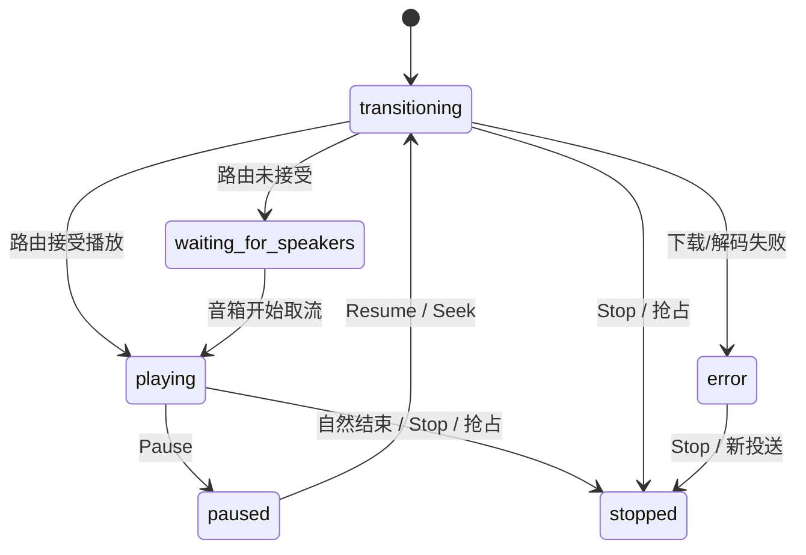
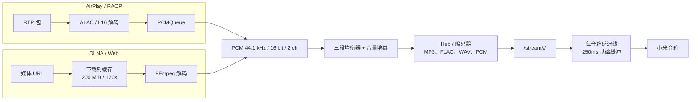
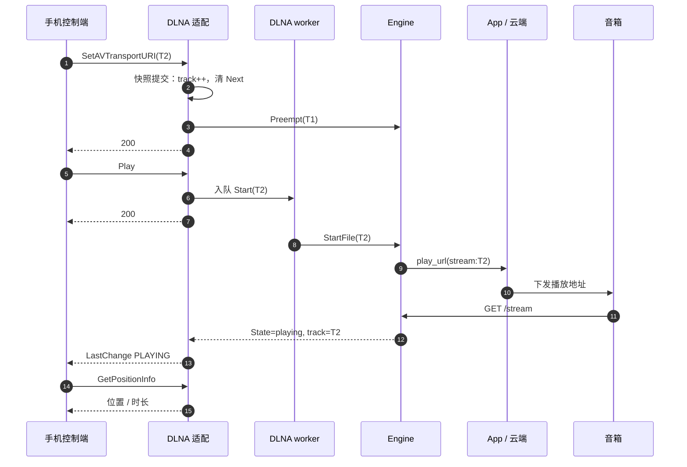
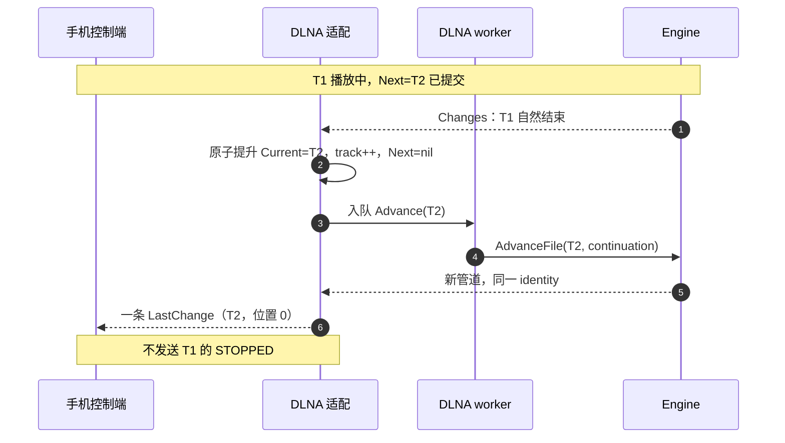

# MiCast Go 技术架构

本文描述 MiCast Go 的实际实现：进程拓扑、播放生命周期、DLNA / AirPlay 适配、音频管线、音箱路由、诊断与部署。内容只描述当前代码，不包含规划或未实现的能力。

## 1. 定位与运行形态

MiCast Go 是一个运行在 NAS 或 PC 上的单进程 Go 服务。它把手机、电脑的音频投送桥接到小米智能音箱：

- 对手机暴露经典 AirPlay（RAOP）和 DLNA MediaRenderer 入口；
- 从手机接收 PCM，或从控制端提供的地址下载媒体；
- 统一解码、均衡、编码后，由小米音箱通过 HTTP 拉取音频；
- 通过米家云端下发 `play_url`、暂停、停止和音量指令。

每台开启的音箱有一个独立 receiver entry，全屋播放另有一个 entry。每个 entry 拥有独立的 `playback.Engine`、`raop.Server`、`dlna.Server` 和数据缓存；同一个 entry 的 AirPlay 与 DLNA 共享一个 Engine。

## 2. 组件拓扑



`receivers.Manager` 负责创建和回收 entry：

- 配置中已加入的音箱各一个 entry；
- 有成员时创建一个全屋 entry；
- 每秒核对一次配置，名称变化只重命名，不重建 Engine；
- 关闭顺序为协议服务器 → Engine → 缓存。

进程入口是 `cmd/micast-go`。默认监听：

| 用途 | 地址 |
| --- | --- |
| 管理页与音频流 | `127.0.0.1:42310`（fnOS 为 `0.0.0.0:42310`） |
| 经典 AirPlay / RAOP | `0.0.0.0:42510` |
| DLNA SSDP | UDP 1900 |
| fnOS 网关 | Unix Socket（可选） |

## 3. 分层职责

| 层 | 包 | 职责 |
| --- | --- | --- |
| 协议适配 | `internal/dlna`、`internal/raop` | SOAP/GENA、RTSP/RTP、协议状态与事件；不持有播放真相 |
| 播放引擎 | `internal/playback` | 会话、源模式、解码/编码、时钟、位置、时长、恢复 |
| 应用层 | `internal/app` | 路由租约、音箱抢占、云端指令、状态回读 |
| 管理服务 | `internal/server` | 管理 API、静态页面、诊断、认证 |
| 发布管理 | `internal/receivers` | 每台音箱/全屋的 entry 生命周期 |
| 持久化 | `internal/store` | 配置、账号保险箱、管理密码、升级备份 |

协议适配层不直接操作音箱；Engine 通过 `app.App` 下发云端指令，App 负责租约与抢占。

## 4. 播放引擎

### 4.1 会话与源模式

Engine 用三种标识描述一次投送：

| 标识 | 含义 |
| --- | --- |
| `identity`（SessionID） | 一次逻辑投送；seek/resume/自动续播保持不变 |
| `trackID`（TrackID） | 协议层识别的当前曲目；换曲递增 |
| 管道 ID（PipelineID） | 每次新建解码管线；seek/resume 会重建 |

播放行为由源模式决定，而不是协议名：

```go
type sourceMode uint8

const (
    streamSource sourceMode = iota // AirPlay：持续 PCM
    fileSource                     // DLNA / Web：有限媒体文件
)
```

- `fileSource`：下载完整媒体后解码；按播放时钟计算位置；EOF 后走自然结束。
- `streamSource`：输入是 RTP/ALAC 解出的 PCM；按帧数计算位置；输入结束即流结束。

### 4.2 启动与命令顺序

所有启动统一经过：

```go
type StartRequest struct {
    Seq          uint64
    Protocol     string
    TrackID      string
    Owner        string
    URI          string
    Track        Track
    Position     float64
    Continuation bool
    AwaitMedia   bool
}
```

`Engine.StartFile` 处理文件源，`Engine.StartStream` 处理 PCM 源，`Engine.AdvanceFile` 在自然结束后衔接下一首。它们返回 `Receipt{Identity, PipelineID, TrackID}`。

每个 entry 的 Engine 维护一个单调递增的 `Sequence`。启动命令携带序号，`acceptStart` 在操作锁内接受不早于上次的启动：

```text
DLNA / RAOP / Web 各自取号
        │
        ▼
Engine.acceptStart(seq)
        │  seq < lastStart → 拒绝
        ▼
newSessionFor(...)
```

这样两个协议同时投送时，后接受的启动生效，排队的旧投送不会把音箱抢回去。

`Engine.Preempt` 立即取消当前管线并异步通知云端停止，不同步等待网络；协议层替换媒体时使用它，保证 SOAP/RTSP 响应不被云端延迟拖住。

### 4.3 状态模型

Engine 的 `State`：

| State | 含义 |
| --- | --- |
| `transitioning` | 会话已建立，下载/解码/路由尚未就绪 |
| `playing` | 路由已接受播放指令 |
| `paused` | 用户暂停 |
| `waiting_for_speakers` | 路由/云端没有接受播放指令 |
| `stopped` | 自然结束、显式停止、被抢占或目标丢失 |
| `error` | 下载、解码、取流或链路失败 |

管理页使用的 `Activity` 是 `State` 的细化：

- `connected`：仅 AirPlay，传输已建立但尚未收到非静音 PCM；
- `transitioning`：仅文件源，路由已接受但音箱尚未打开 `/stream`；
- 其他情况与 `State` 相同。



文件源的自然结束由 `finishMedia` 判定：等待已解码音频按播放时钟排空，并等待所有音箱结束本次取流，然后调用 `stop(finished=true)`。流源在输入结束后最多等待 7 秒再停止。

### 4.4 位置与时长

位置来自实际播放时钟：

- `fileSource`：`position + min(decodedFrames/44100, now - playbackStart)`；暂停时冻结在 `pausedAt`，恢复和 seek 更新基准。
- `streamSource`：`position + decodedFrames/44100`。

DLNA 的 `GetPositionInfo` 只在 Engine 音轨代次（TrackID）与当前曲目一致时读取位置，避免旧管线覆盖新曲。播放中对外位置封顶在 `duration - 1` 秒。

时长来源顺序：

1. 控制端 DIDL 中与当前 URI 匹配的 `res@duration`；
2. 下载完成后由 FFmpeg 读取的容器时长；
3. 未知时返回 `00:00:00`。

时长探测使用随包 FFmpeg 的 `-i` 输出，不触发解码，预算 2 秒；结果按当前会话提交。发布包未包含 ffprobe。

## 5. 音频管线



- 解码统一为 44.1 kHz、16 bit、双声道 PCM。
- MP3、FLAC 经 `audio.Transcode` 编码；WAV/PCM 直接写 PCM。
- 每个格式一个 Hub 与 PCMQueue；音箱只读取自己格式的流。
- `delayLine` 为每台音箱保留 `DelayMS + 250ms` 的发送缓冲，0–5000ms；用于多音箱对齐，不改变内容与音高。
- 流式输入在 150ms 到达间隙后开始消耗缓冲；最大滞后 4 秒，超出的旧分片会被跳过并记录。
- 下载缓存只有一个文件；换曲、停止、抢占或关闭时清理。

Engine 每 3 秒检查取流健康，约每 30 秒回读音箱状态。持续无输出会进入恢复流程：确认异常、重试目标、重新流动后清零；超过 90 秒仍无输出则结束会话。

## 6. DLNA MediaRenderer

### 6.1 服务与声明

DLNA entry 提供三个 UPnP 服务：

- `AVTransport:1`
- `RenderingControl:1`
- `ConnectionManager:1`

`scpd.xml` 声明动作、参数方向与关联状态变量。`GetPositionInfo.TrackURI` 关联 `CurrentTrackURI`；所有返回字段与声明一致，时间格式为 `HH:MM:SS` 整数秒。

设备描述包含：

- `DMR-1.50`；
- 三个服务的 SCPD / control / event URL；
- 稳定的 UDN 与 `BOOTID.UPNP.ORG`。

发现使用 SSDP：响应 `M-SEARCH`，发送 `ssdp:alive` / `ssdp:byebye`；多个 receiver 共享一个发现监听器。

### 6.2 协议状态

`dlna.Server` 用 `stateMu` 保护协议状态，用 `jobs` 队列串行执行引擎操作。SOAP 处理只做校验、提交意图和入队，不等待下载、云端或解码。

```go
type Snapshot struct {
    Current, Next          Media
    HasMedia, HasNext      bool
    State, Status, Actions string
    Position, Duration     float64
}
```

`Snapshot` 是所有查询与事件的唯一来源。Server 另外保存：

- CastID：一次投送事务；SetAVTransportURI、Stop、外部接管时递增；
- TrackID：当前媒体代次；换曲递增；
- owner / engineTrackID：提交成功的 Engine 会话与音轨代次；位置只在两者匹配时取自 Engine；
- Position：当前 TrackID 的播放位置；不匹配时使用本曲基线。

### 6.3 三条换歌路径

**控制端推新 URI，再 Play**



`SetAVTransportURI` 只提交意图并抢占旧管线；真正的下载与路由在 worker 中完成。`Play` 幂等：已在播放同一 TrackID 时不重开管线。

**有 Next，当前自然结束**



**当前结束且没有 Next**

保持 Current 与最终位置，状态变为 STOPPED，发送一次 STOPPED；不清理 URI，控制端随后可以重新 Play。

显式 Stop 会递增 CastID、清空 Next、抢占当前管线；迟到的 EOF、下载、探测和旧任务因代次不匹配被丢弃。

### 6.4 查询与事件

- `GetTransportInfo`、`GetPositionInfo`、`GetMediaInfo`、`GetCurrentTransportActions` 从快照和 Engine.Status 生成，不持有网络锁。
- `GetPositionInfo` 返回 `TrackURI`、`TrackDuration`、`TrackMetaData`、`RelTime`、`AbsTime`；播放中位置封顶 `duration-1`。
- `GetMediaInfo` 的 `NrTracks` 与 `GetPositionInfo.Track` 随 Current 是否存在返回 1/0。
- LastChange 由一次完整快照生成，字段包括 `TransportState`、`TransportStatus`、`TransportPlaySpeed`、`AVTransportURI(+MetaData)`、`CurrentTrack`、`CurrentTrackURI(+MetaData/+Duration)`、`CurrentMediaDuration`、`NextAVTransportURI(+MetaData)`、`NumberOfTracks`、`CurrentTransportActions`。
- 位置与计数器不进入 LastChange。
- 事件循环每 250ms 检查快照变化；订阅续期重发最新快照，SEQ 不重置。
- 订阅上限 32 个、每 peer 16 个；默认 1800 秒；回调 3 秒超时，失败按指数退避重试。

## 7. AirPlay / RAOP

RAOP 是 iPhone/Apple Music 等发送端的经典 AirPlay 入口：

- RTSP：`OPTIONS`、`ANNOUNCE`、`SETUP`、`RECORD`、`FLUSH`、`PAUSE`、`SET_PARAMETER`、`GET_PARAMETER`、`TEARDOWN`。
- 音频：44.1 kHz / 16 bit / 双声道 ALAC，或 L16 原始 PCM。
- 传输：RTP over UDP，控制通道请求丢包重发，timing 通道回 NTP 时间。
- 元数据：`SET_PARAMETER` 的 DMAP 更新歌名、歌手、专辑；不重建会话。
- 会话：一个 RTSP 连接跨多首歌；`RECORD` 重复发送表示恢复或继续；`FLUSH` 只清传输缓冲；`TEARDOWN` 或连接断开结束投送。
- 音量：发送端以 dB 表示，映射到 0–100；首次音量在 `RECORD` 前到达时先保存在连接上。

RAOP 收到的 PCM 进入 `PCMQueue`，之后的编码、供流和延迟与 DLNA 共用同一条输出管线。

### 7.1 与 DLNA 的差异

| 维度 | AirPlay / RAOP | DLNA |
| --- | --- | --- |
| 输入 | 手机持续推 RTP/ALAC | 控制端给 URI，MiCast 下载文件 |
| 会话 | 一个连接跨多首 | 每首一个文件会话 |
| 换歌 | 更新 DMAP 元数据，不重建会话 | 新 URI 或 Next 提升，TrackID 递增 |
| 进度来源 | 接收端按帧数计算，发送端自己显示 | 控制端轮询 `GetPositionInfo` |
| 结束 | 连接断开 / 输入结束 | 文件 EOF |
| 下一首 | 无协议级 Next | `SetNextAVTransportURI` + 自动提升 |
| 输出 | 音箱拉 `/stream` | 音箱拉 `/stream` |

两种输入最终都经过同一个 Engine、同一套编码与供流；差异在源模式和协议状态，不在输出链路。

## 8. 音箱路由与云端

`app.App` 为每个路由维护：

- `source` / `audioID`：当前流来源；
- `revision`：命令代次，旧命令回写前校验；
- `owned` / `blocked`：当前路由拥有的音箱，以及被新投送抢占的音箱；
- 每个物理音箱一个 lease；新投送会取消旧 lease。

`BeginGuardedRouteStream` 把 `/stream/...` 地址作为 `play_url` 下发给音箱；`ControlRouteSource` 只对 `source` 匹配的音箱执行暂停/播放/停止/音量。Engine 的旧引用不能命令重新创建的入口。

活跃投送约每 30 秒回读音箱状态；回读结果按租约隔离，不改变保存的音量，也不覆盖新会话。

## 9. 诊断

管理页“导出诊断”调用 `POST /api/diagnostics/export`，在应用数据目录写入：

```text
<data-dir>/micast-go/
  diagnostics-YYYYMMDD-HHMMSS.txt
  latest.txt
```

- 最多保留 10 份；`latest.txt` 始终是最新报告。
- 文本内容包括：版本、时间、数据目录、每个路由的协议/状态/错误/结束原因/位置/时长、每条音箱的取流字节/健康/连接数、播放事件、DLNA 订阅与命令序列、音箱回报状态。
- 协议事件对只读轮询最多每 5 秒采样一次；换歌、播放、停止、定位等命令始终保留，最多 128 条。
- 报告不包含媒体 URL、回调地址、账号凭据、歌曲名称或元数据内容。
- fnOS 卸载“删除全部”只删除登录、配置、日志、缓存和升级备份；`micast-go` 诊断目录及其他用户文件保留，需手动清理。

## 10. 部署与数据

发布产物：

- Windows/ Linux amd64/arm64 单文件二进制；
- fnOS x86/arm `.fpk` 包，包含服务脚本、Web 资源、图标、FFmpeg 运行时和许可文件。

数据目录由 `--data-dir` 指定，默认 `data`；fnOS 使用 `TRIM_PKGVAR`。主要文件：

| 文件/目录 | 内容 |
| --- | --- |
| `config.json` | 音箱、格式、音量、延迟、全屋成员 |
| `account.enc` / `account.key` | 加密的米家登录凭据 |
| `access.key` / `admin-password` | 管理页认证 |
| `cache/` | 下载的媒体缓存 |
| `micast-go.log` | 运行日志（fnOS 启动时轮转，5 MiB） |
| `micast-go/` | 诊断报告 |

fnOS 服务以 `micast-go` 用户运行，数据目录权限 0700；管理页可通过 fnOS 网关的 Unix Socket 或 42310 端口访问。

## 11. 测试与构建

```text
go test ./...          单元与集成测试
go vet ./...           静态检查
python scripts/fnos-lifecycle.test.py   fnOS 生命周期脚本测试（需要 Git Bash）
scripts/build.ps1      Windows / Linux 二进制
scripts/build-fnos.ps1 fnOS x86 / arm 安装包（需要 fnpack 与音频运行时）
```

测试覆盖：

- DLNA 三条换歌路径、事件字段、订阅续期、位置/时长、慢云端下的响应预算、诊断脱敏；
- Engine 会话替换、自动续播、暂停/恢复、预取、音量、恢复、位置时钟；
- RAOP RTSP 流程、重复 RECORD、FLUSH、元数据、丢包重传；
- receiver entry 创建/回收、并发会话、全屋路由；
- fnOS 安装、升级、卸载和“删除全部”范围。

集成测试需要 FFmpeg 与局域网接口；缺失时自动跳过。
